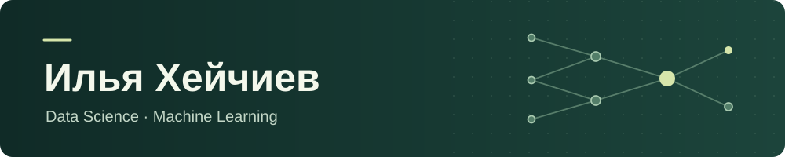

  

Учусь на прикладной математике в НИТУ МИСИС. В проектах работаю с рекомендациями, табличными данными и NLP. Мне интересно сравнивать модели на отложенных данных и разбираться, какие признаки и решения дают прирост. Рассматриваю стажировки и junior-позиции в Data Science.

## Основные проекты

<table>
  <tr>
    <td width="50%" valign="top">
      <strong>KION Recommendation System</strong> 
      Рекомендации · локальный проект
      
Двухэтапная выдача фильмов и сериалов на датасете из 5,48 млн взаимодействий. Объединил кандидатов нескольких моделей и обучил ранкер CatBoost PairLogit.

      
<b>MAP@10 0,1456</b> на последней неделе. На трёх недельных срезах прирост к популярности за 7–14 дней составил 9,0–10,3%.

    </td>
    <td width="50%" valign="top">
      <strong><a href="https://github.com/novaeKH/Credit-scoring">Credit Scoring</a></strong> 
      Табличное ML · кредитный риск
      
Собрал 226 признаков из семи таблиц Home Credit для 307 тыс. клиентов. Сравнил вклад кредитной истории и проверил калибровку вероятностей.

      
<b>ROC-AUC 0,7859 · AP 0,2870</b> у CatBoost на отложенной выборке.

    </td>
  </tr>
  <tr>
    <td width="50%" valign="top">
      <strong><a href="https://github.com/novaeKH/banking-intent-classifier">Banking77</a></strong> 
      NLP · маршрутизация обращений
      
Сравнил TF-IDF и DistilBERT на 77 темах, отдельно подобрал порог передачи оператору и измерил задержку на CPU.

      
<b>Macro F1 0,9019</b> на официальном тесте. При выбранном пороге модель приняла 87,4% обращений с точностью 94,8%.

    </td>
    <td width="50%" valign="top">
      <strong><a href="https://github.com/novaeKH/hotel-cancellation-ml">Hotel Booking</a></strong> 
      Сезонность · временная валидация
      
Прогноз поздней отмены или незаезда вечером перед заездом. Сравнил переобучение и календарные признаки на шести месяцах.

      
<b>84 из 357 поздних отмен</b> попали в список CatBoost при отборе 10,9% броней. Logistic Regression нашла столько же.

    </td>
  </tr>
</table>

## Навыки

| Область | Методы и инструменты |
| :--- | :--- |
| **Языки и базы данных** | Python, SQL, PostgreSQL, SQLite. JOIN, GROUP BY, подзапросы, CTE и оконные функции. |
| **Анализ данных** | pandas, NumPy, SciPy, Matplotlib, Jupyter. EDA, очистка данных и построение признаков. |
| **Классическое ML** | Линейные модели с регуляризацией, деревья решений, бэггинг и Random Forest, градиентный бустинг, kNN, K-means, PCA. scikit-learn, CatBoost, LightGBM. |
| **Рекомендации и ранжирование** | ItemKNN, ALS, BPR, рекомендации по метаданным, генерация кандидатов, CatBoost Ranking. |
| **NLP и глубокое обучение** | PyTorch, Hugging Face Transformers, TF-IDF и BPE. Transformer Encoder и decoder-only модели с нуля, дообучение DistilBERT. Для RAG использовал BM25, эмбеддинги и Ollama. |
| **Оценка моделей** | Кросс-валидация, временные и групповые разбиения, подбор параметров и порогов, разбор ошибок, калибровка. ROC-AUC, Average Precision, macro F1, MAP@K и NDCG@K. |
| **Инженерия** | Git, Linux, FastAPI, REST API, Redis, Docker и Docker Compose. В приложениях работал с React и TypeScript. |
| **Математика и алгоритмы** | Линейная алгебра, теория вероятностей, математическая статистика, алгоритмы и структуры данных. Изучал генетические алгоритмы. |

## Другие проекты

- [**StoryWeaver**](https://github.com/novaeKH/StoryWeaver) — decoder-only Transformer на 126 млн параметров, обученный с нуля для генерации рассказов. Реализовал RoPE, GQA и KV-кэш, сравнил чекпоинты на одинаковых заданиях.
- [**ML Vault Agent**](https://github.com/novaeKH/ml-vault-agent) — локальный RAG по заметкам Obsidian. Объединил BM25 и поиск по эмбеддингам, оценил retrieval по Recall@k и MRR.
- [**DataPath**](https://github.com/novaeKH/DataPath) — приложение для изучения DS и ML с тренажёрами SQL и Python и интерактивными лабораториями. [Открыть веб-версию](https://novaekh.github.io/DataPath/).
- [**Takt**](https://github.com/novaeKH/takt-ai-control-center) — сбор телеметрии AI-систем, учёт стоимости LLM-вызовов и отчёты по запускам.
- [**RetailRec**](https://github.com/novaeKH/RetailRec) — персональный топ-10 товаров на RetailRocket. Сравнил ItemKNN, ALS и популярность на 14-дневном отложенном периоде.
- [**Bank Marketing Prioritization**](https://github.com/novaeKH/bank-marketing-prioritization) — приоритизация банковского обзвона при бюджете в 10% клиентской базы.
